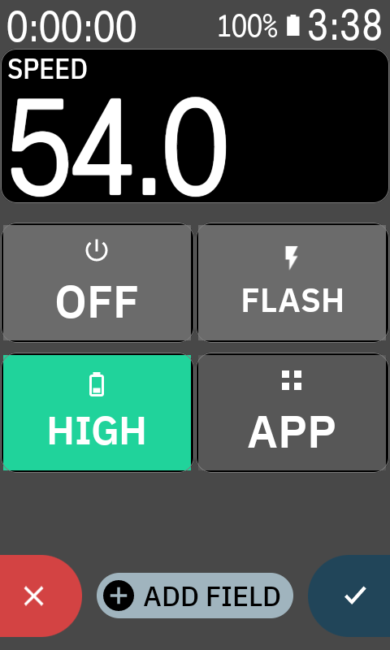
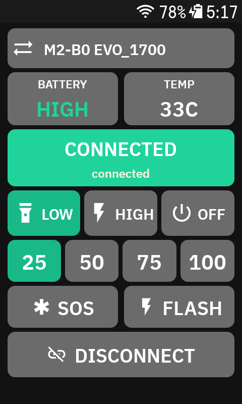

# Magicshine Controls for Karoo

Control a Magicshine EVO 1700 from your Hammerhead Karoo. Keep the four controls in one strip, or put just **Flash** next to your speed. A tap flashes the light for two seconds, then restores what you were riding with, even if the light was off.

[Download the 1.1 APK](https://github.com/lenne0815/karoo-magicshine-controls/releases/download/v1.1/karoo-magicshine-controls-1.1.apk) · [Release notes](CHANGELOG.md)

| Ride profile editor | Connected EVO 1700 |
| :---: | :---: |
|  |  |

The left screen is an editor preview with sample values. The right screen shows readings from a connected lamp.

## Set up the light

Install the APK on the Karoo. If you already have the extension, use **Update** in the Karoo Extensions Library. Turn the lamp on, open **Magicshine Controls**, select your lamp and tap **Connect**. Connecting reads the lamp status without changing its beam.

In the app, choose the low or high beam and set it to **25, 50, 75 or 100%**. **SOS** and **Flash** here are continuous modes, unlike the two-second flash on the ride page. The app also shows the lamp temperature and has a **Disconnect** button.

## Choose your ride fields

In the Karoo profile editor, open a data page and choose **Add Field**. Use **Light Controls** for the original full-width strip. If it's already in your profile, there's nothing to change. For a different layout, add any of these separately, alongside ordinary Karoo data:

| Field | What it does |
| --- | --- |
| **Light On/Off** | Switches off, or brings back your last beam, brightness and mode. |
| **Flash** | Flashes for two seconds and returns to the previous setting. |
| **Light Battery** | Shows the lamp battery, not the Karoo battery. It's a readout, not a button. |
| **Open App** | Opens the full control screen. This field alone doesn't request a lamp connection. |

## What the battery reading means

On the tested **EVO 1700 (firmware v1)**, a full discharge produced only three Bluetooth values: 100, 50 and 30. The last value stayed at 30 until shutdown. That's why the field says **HIGH**, **MID** or **LOW**, rather than promising 30% when the lamp is about to go out. Missing or unrecognised readings show **--**. Firmware that reports a continuous level can display a percentage.

The selector recognises Bluetooth names beginning with `M1-B0`, `M1-BO`, `M2-B0` or `M2-BO`. A matching name alone doesn't mean every feature has been tested on that model.

[Battery capture and protocol notes](MAGICSHINE_BLE_SNIFFER_NOTES.md) · [Ride field layout](docs/ride-field-layout.md) · [Separate SRAM sniffer](SRAM_SNIFFER_NOTES.md)

MIT License
